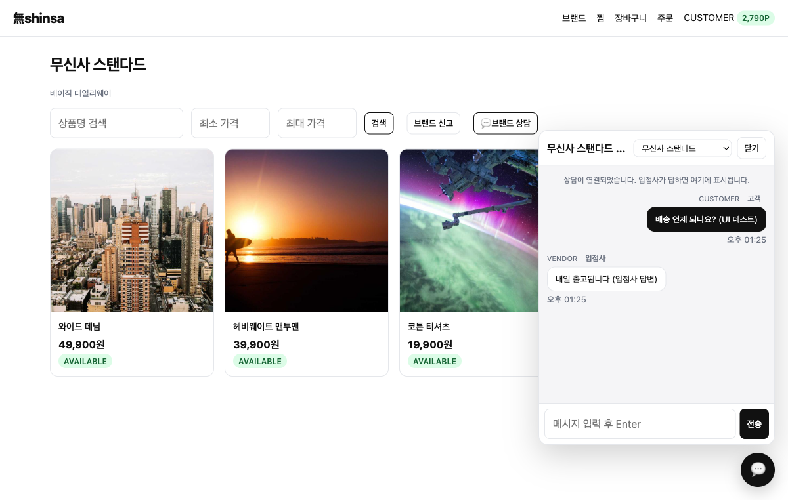
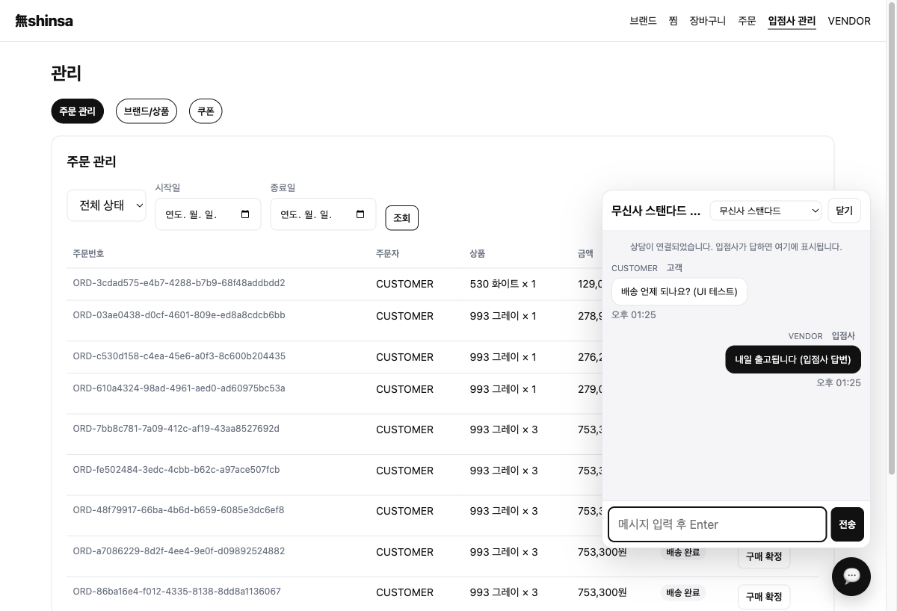
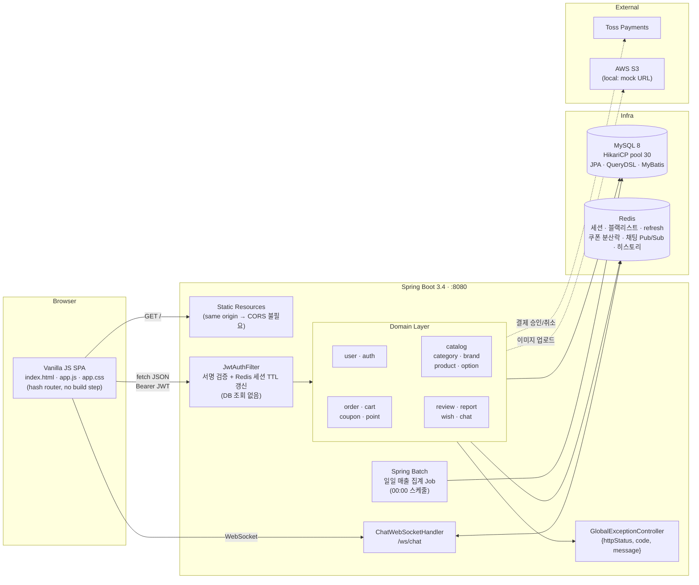
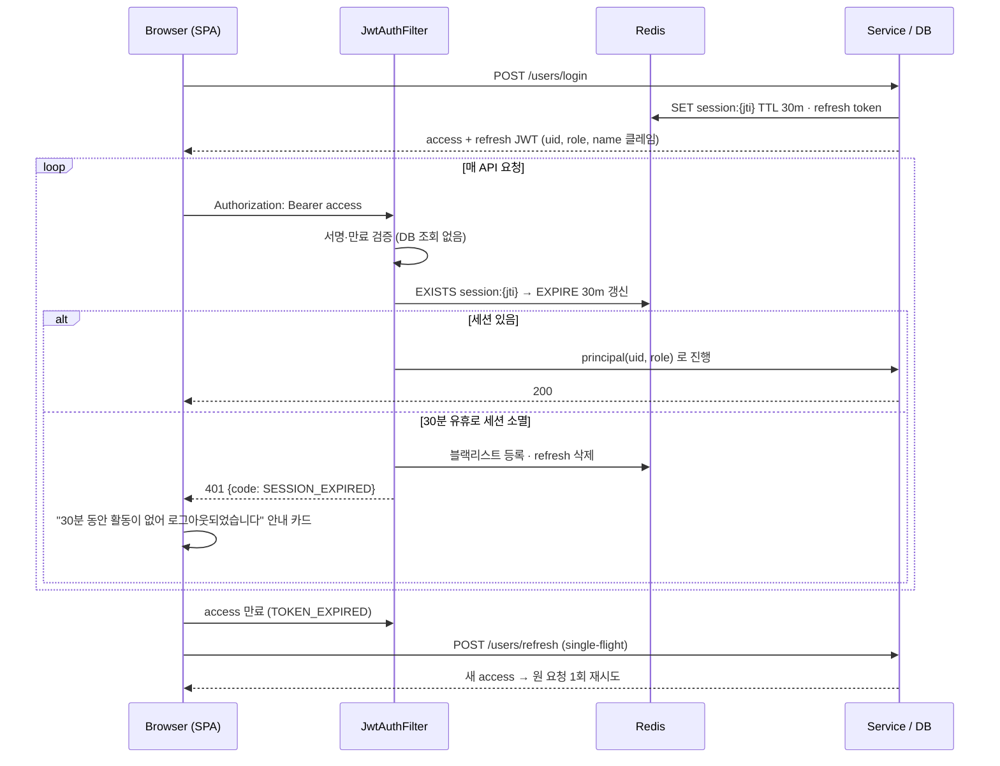
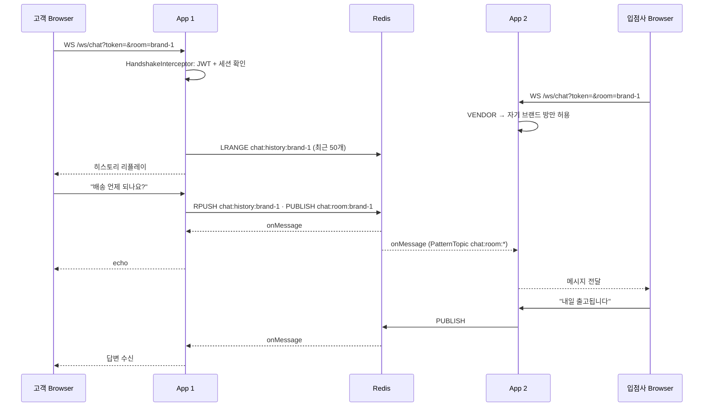

# 無shinsa (Soo-Shinsa)

> 무신사·쿠팡을 모티브로 한 **멀티 브랜드 패션 이커머스**.
> Spring Boot 백엔드 + 같은 포트에서 서빙되는 바닐라 JS SPA 프론트까지 한 저장소에서 완성한 풀스택 포트폴리오입니다.

<p>


</p>

| 항목 | 내용 |
|---|---|
| 기간 | 2024.01 ~ 2024.02 (팀 MVP1) → 2025 ~ 2026.11 (개인 MVP2·프론트·성능·실시간 기능) |
| 역할 | **황상익** — Image, Report, Product/Option, CartItem, Coupon, Review, Category/Brand 리팩토링, AWS, 동적 쿼리, 그리고 MVP2 이후 전체(프론트 SPA·보안·성능·찜/포인트/채팅) |
| 팀 (MVP1) | 이해욱 Order·Toss / 권진석 Category·Brand / 김민경 User·통계 |
| ERD | https://www.erdcloud.com/d/vHWtykYujZaDJdLpc |
| 규모 | Java 소스 234 파일 · REST 엔드포인트 79개 · 프론트 SPA 1 파일(app.js) |
| 테스트 | 단위 87 · 계약(프론트↔백) 391 · 통합(동시성) · JMeter 부하 · Playwright E2E |

---

## 목차

1. [한눈에 보기](#1-한눈에-보기)
2. [아키텍처](#2-아키텍처)
3. [기능](#3-기능)
4. [기술적으로 집중한 부분](#4-기술적으로-집중한-부분)
5. [성능 — 병목을 찾고 4배 개선](#5-성능--병목을-찾고-4배-개선)
6. [테스트 전략](#6-테스트-전략)
7. [실행 방법](#7-실행-방법)
8. [API 요약](#8-api-요약)
9. [트러블슈팅 기록](#9-트러블슈팅-기록)

---

## 1. 한눈에 보기

- **고객**: 카테고리 → 브랜드 → 상품 탐색, 옵션 선택 장바구니, 쿠폰·포인트 적용 주문, Toss 결제, 리뷰·신고, 찜, 입점사와 실시간 상담 채팅
- **입점사(VENDOR)**: 내 브랜드 상품·옵션 관리, 내 브랜드가 포함된 주문의 결제/배송 상태 처리, 고객 상담 응대, 매출 통계
- **관리자(ADMIN)**: 카테고리/브랜드/쿠폰 관리, 신고 처리(승인/반려 사유), 전체 주문·통계, 통계 즉시 집계
- **운영 품질**: DB 조회 없는 JWT 세션(30분 슬라이딩), 사용자 친화적 오류 코드, 커넥션 풀/OSIV 튜닝, 분산 락 쿠폰, 야간 배치 통계, CI

<p align="center">


</p>

---

## 2. 아키텍처

### 시스템 구성



### 요청 흐름 — 로그인 세션과 자동 로그아웃



### 요청 흐름 — 입점사 상담 채팅 (다중 인스턴스 대응)



- **프론트를 백엔드와 같은 origin**에서 서빙 → CORS·빌드 도구·Node 없이 `./gradlew bootRun` 하나로 전체 데모
- 도메인 패키지 단위 구성: `user · auth · brand · category · product · cartitem · order · coupon · review · report · statistics · wish · chat · image`
- 결제는 Toss Payments 테스트 연동(`#/pay/{orderId}`), 이미지는 local 프로필에서 S3 대신 mock URL

---

## 3. 기능

| 영역 | 내용 |
|---|---|
| 회원 | 가입/로그인/탈퇴/재가입 구분(`EMAIL_DELETED`), 등급(BRONZE→VIP)별 포인트 적립률, 주소 |
| 인증 | JWT Access + Refresh, 로그아웃 블랙리스트, 30분 유휴 시 자동 로그아웃, 탭 간 로그아웃 동기화 |
| 카탈로그 | 카테고리 → 서브카테고리 → 브랜드 → 상품 → 옵션, 페이지네이션, 상품 상태 |
| 장바구니·주문 | 옵션별 담기, 쿠폰(%) + 포인트 동시 적용, 단건/장바구니 주문, 상태 전이 규칙(고객은 취소/반품/교환 신청만, 결제·배송은 스태프만) |
| 결제 | Toss 결제 승인 → `PAYMENTCOMPLETED` 전이, 멱등 처리 |
| 포인트 | 결제 완료 시 등급 적립률로 적립, 취소/반품 시 1회만 환급(멱등 플래그), 주문 총액 초과·잔액 부족 검증 |
| 쿠폰 | Redisson 분산 락 + AOP로 한정 수량 발급, 사용 쿠폰 제외 드롭다운, 내 쿠폰 내역 |
| 리뷰·신고 | 본인 리뷰만 수정/삭제, 별점 조회, 신고 → 관리자 승인/반려(사유) → 내 신고 내역 |
| 찜 | 상품 ♡ 토글, 찜 목록, 상품 삭제 시 연쇄 정리 |
| 상담 채팅 | 브랜드별 채팅방, WebSocket + Redis Pub/Sub(다중 인스턴스 대응), 최근 50개 히스토리 리플레이, VENDOR는 자기 브랜드만 |
| 백오피스 | 입점사 상품/옵션 관리, 주문 관리(ADMIN 전체 / VENDOR 자기 브랜드 포함 주문), 통계 탭 즉시 집계 |
| 통계 | Spring Batch 야간 집계(전날 주문) + MyBatis 조회, 브랜드×날짜 매출/수량 매트릭스 |
| 프론트 UX | 로딩 바, 오류 사유 카드(세션 만료/권한 없음), 모바일 ≤640px 2열 레이아웃, 페이지 제목 |

---

## 4. 기술적으로 집중한 부분

### 4-1. DB 조회 없는 JWT 세션 + 30분 슬라이딩 만료
- 기존: 필터에서 매 요청 사용자 조회 → 부하 시 커넥션 경합의 주범.
- 변경: 토큰에 `uid / role / name` 클레임을 넣고 **필터는 서명 검증만** 수행. 세션 존재 여부는 Redis 키(`TTL 30분`)로 확인하고 요청마다 TTL 갱신.
- 30분 동안 요청이 없으면 다음 요청에서 토큰을 **블랙리스트**에 넣고 refresh token을 삭제 → 강제 로그아웃. 로그아웃도 같은 블랙리스트 경로.
- 구버전 토큰(클레임 누락)은 500이 아니라 `INVALID_TOKEN` 401로 안전하게 거절.

### 4-2. 사용자가 이해할 수 있는 오류 응답
- 모든 오류는 `{httpStatus, code, message}`. 401은 **이유별 코드**로 나눔: `NO_TOKEN · TOKEN_EXPIRED(→자동 갱신) · SESSION_EXPIRED · LOGGED_OUT · INVALID_TOKEN`, 권한 부족은 403 `NO_AUTHORITY`.
- 프론트는 코드별 안내 카드(“30분 동안 활동이 없어 로그아웃되었습니다” 등)를 띄우고, `TOKEN_EXPIRED`는 **single-flight refresh**로 한 번만 갱신 후 원 요청을 재시도.

### 4-3. OSIV off + 필요한 곳에만 읽기 트랜잭션
- `spring.jpa.open-in-view=false`로 뷰 렌더링까지 커넥션을 쥐는 문제 제거.
- 그 대신 `LazyInitializationException`이 나는 **조회 메서드 5곳에만** `@Transactional(readOnly = true)`를 둠(주문 조회, 장바구니 조회). 쓰기 경로(주문 생성, 재고 차감, 포인트 정산)는 기존 `@Transactional` 유지. 전 서비스 일괄 적용은 하지 않음.

### 4-4. 포인트 정산의 멱등성
- `Orders.pointSettled / pointRefunded` 플래그로 결제 완료 적립·취소 환급이 **상태 전이가 여러 번 호출돼도 1회만** 반영.
- 사용 포인트는 `totalPrice = max(0, 상품합 − 쿠폰 − 포인트)`로 주문 엔티티가 스스로 재계산.

### 4-5. 쿠폰 발급 동시성
- 4,000 동시 요청 / 발급 한도 10개 시나리오에서 `issuedCount` 꼬임 → **Redisson 분산 락을 AOP로 트랜잭션 바깥에서 선점**하고 내부에서 트랜잭션 시작. 통합 테스트로 재현·검증.

### 4-6. 실시간 상담 채팅
- `TextWebSocketHandler` + Redis `PatternTopic("chat:room:*")` 구독. 메시지는 Redis로 publish → 모든 서버 인스턴스가 해당 방 세션에 전달 → 수평 확장 가능.
- 핸드셰이크 인터셉터에서 JWT 검증 + Redis 세션 확인 + **VENDOR는 자기 브랜드 방만** 허용(`CHAT_ROOM_FORBIDDEN`).
- 히스토리는 Redis List(`chat:history:{room}`, 최근 50개)로 재접속 시 리플레이.

### 4-7. QueryDSL 동적 조회
- 동적 조건을 Service가 아닌 `CustomRepository`로 이동, `Projections.constructor`로 필요한 컬럼만 DTO 프로젝션.
- QueryDSL 기본 path depth(2) 때문에 `orderItem.product.brand.user`가 null이 되는 문제 → 명시적 join으로 해결.

---

## 5. 성능 — 병목을 찾고 4배 개선

JMeter(`scripts/jmeter/run-ramp.sh`)로 스레드당 로그인 1회 후 “브랜드 둘러보기 → 장바구니 → 주문내역” 루프, 50 → 100 → 200 → 400 스레드 램프.

| 단계 | 결과 |
|---|---|
| 1차 (Hikari 10, OSIV on, 필터에서 DB 조회) | 200 스레드에서 커넥션 타임아웃 **259건**, 모든 요청이 커넥션 대기 → 병목 = **DB 커넥션 풀** |
| 2차 (Hikari 30, OSIV off, 읽기 트랜잭션 5곳) | 타임아웃 0, `LazyInitializationException` 잡아가며 범위 최소화 |
| 3차 (JWT 세션화: 필터 DB 조회 제거) | 혼합 시나리오 **~400–500 TPS** 플래토, 앱 CPU ~450% (bcrypt 로그인 ~22/s가 지배) |

- 결론: 단일 노트북 서버 기준 400 TPS 플래토는 서버 자원 한계이며, 애플리케이션 레벨 병목(커넥션 대기·필터 DB 조회)은 제거됨.
- 측정 결과는 `build/jmeter/` 에 저장.

---

## 6. 테스트 전략

| 종류 | 명령 | 내용 |
|---|---|---|
| 단위 (87) | `./gradlew test` | Mockito, DB 불필요. 주문 상태 전이·소유권, 쿠폰 적용, 결제 멱등, 포인트 적립/환급 멱등, 찜 중복, 채팅 핸드셰이크 권한·Pub/Sub 라우팅, JWT 필터 세션, 통계 집계, 예외 응답 |
| 통합 | `./gradlew test -Pintegration` | MySQL/Redis 필요. 쿠폰 동시 발급 경합 |
| 계약 (391) | `python3 scripts/contract-test.py` | 서버 기동 후 **프론트가 실제로 읽는 필드/PK ↔ 백엔드 응답**을 전부 대조. 페이지네이션, 주문 관리, 찜, 포인트(적립·중복 적립 없음·사용·취소 환급 1회), 채팅(raw RFC6455 클라이언트로 핸드셰이크·권한·Pub/Sub·히스토리) |
| 부하 | `scripts/jmeter/run-ramp.sh [초] ["50 100 200 400"]` | 위 5장 |
| E2E | Playwright | 고객/입점사 두 컨텍스트로 찜 토글, 포인트 사용 주문(19,900 → 19,400원), 양방향 채팅, 모바일 390px 레이아웃 확인 |
| CI | `.github/workflows/ci.yml` | 푸시마다 단위 테스트 |

---

## 7. 실행 방법

```bash
brew services start redis                    # Redis 필수
# src/main/resources/application-local.properties 에 MySQL 비밀번호 입력 (DB 자동 생성)
./gradlew bootRun                            # http://localhost:8080
python3 scripts/seed-local.py                # 테스트 계정 + 카테고리/브랜드/상품 시드
python3 scripts/seed-stats.py                # (선택) 브랜드별 30일 mock 주문 → 통계 탭 즉시 확인
python3 scripts/reset-local.py --yes         # 로컬 DB/Redis 초기화
```

테스트 계정: `ADMIN@test.com` / `VENDOR@test.com` / `CUSTOMER@test.com` (비밀번호 `Passw0rd!`)

- 고객: 브랜드 둘러보기 → 상품 ♡ 찜 → 장바구니(쿠폰·포인트 입력) → 주문 → `#/pay/{orderId}` Toss 테스트 결제 → 리뷰/신고 → 우측 하단 💬 상담
- 입점사/관리자: 상단 `관리` 메뉴(카테고리 → 서브카테고리 → 브랜드 → 상품 → 옵션), `주문 관리`, `통계 > 이 날짜 집계`
- 프론트(`static/app.js`)만 고친 경우 `./gradlew processResources` 로 재배치(서버 재시작 불필요)

---

## 8. API 요약

| 도메인 | 엔드포인트 |
|---|---|
| 인증/회원 | `POST /users/signin` `POST /users/login` `POST /users/logout` `POST /users/refresh` `GET/PATCH /users` `POST /users/leave` |
| 카탈로그 | `GET /categories` `GET /sub-categories` `GET /brands` `GET /brands/{id}` `GET /products/brands/{brandId}` `GET /products/{id}` `GET /options/{id}` (스태프: `POST/PATCH/DELETE`) |
| 장바구니 | `POST /carts` `GET /carts/users` `PATCH/DELETE /carts/{id}` `POST /carts/{id}/apply-coupon` |
| 주문 | `POST /orders/carts {usePoint}` `POST /orders/single` `GET /orders/users` `GET /orders/{id}` `PATCH /orders` `GET /orders/manage` |
| 결제(Toss) | `GET /api/client-key` `POST /api/create` `POST /api/cancel` `GET /success` `GET /api/fail` |
| 쿠폰 | `POST /coupons` `GET /coupons` `GET /coupons/me` |
| 리뷰 | `POST /reviews/order-item/{orderItemId}` `GET /reviews/products/{productId}` `PATCH/DELETE /reviews/{id}` |
| 신고 | `POST /reports` `GET /reports/me` `GET /reports` `PATCH /reports/{id}/status` |
| 찜 | `GET /wishes` `POST/DELETE /wishes/{productId}` |
| 채팅 | `GET /chat/rooms` · WebSocket `/ws/chat?token=&room=` |
| 통계 | `GET /admin/statistics/sales` `GET /admin/statistics/count` `POST /admin/statistics/aggregate?date=` |

오류 응답 형식: `{ "httpStatus": 401, "code": "SESSION_EXPIRED", "message": "30분 동안 활동이 없어 로그아웃되었습니다." }`

---

## 9. 트러블슈팅 기록

MVP1/MVP2 개발 과정에서 부딪힌 문제와 해결 과정은 별도 문서로 정리했습니다.

👉 **[docs/TROUBLESHOOTING.md](docs/TROUBLESHOOTING.md)**

- MVP1: QueryDSL DTO 프로젝션, 쿠폰 발급 Deadlock(비관적 락), 쿠폰 재고, Redis 토큰 관리
- MVP2: 연관관계 재설계(Category → SubCategory → Brand), 쿠폰 AOP 분산 락, BlackList/Refresh Token, Security 필터·SecurityContext 이슈
